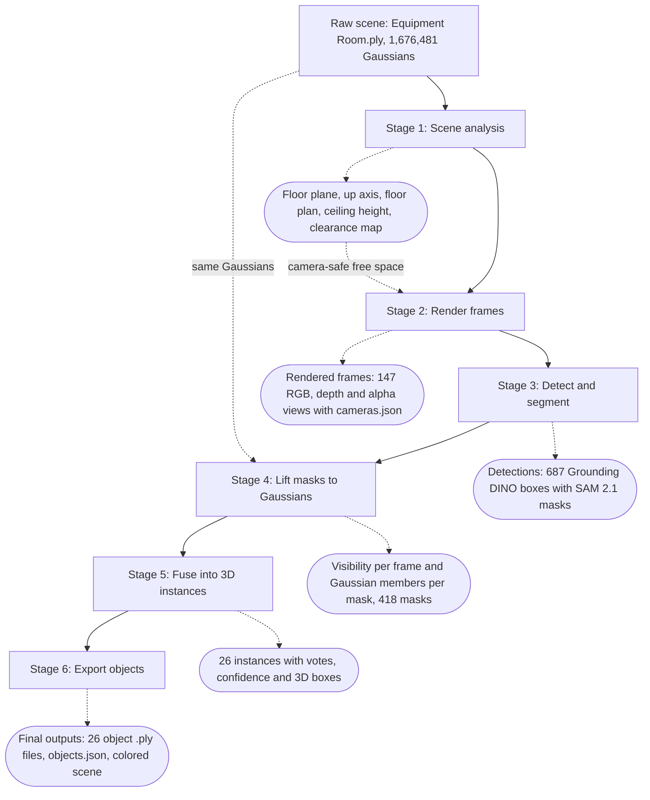

# Methodology: Object Extraction from a 3D Gaussian Splatting Scene

This document describes how the object splats in `outputs/equipment_room/objects/` were produced from the raw scene `Equipment Room.ply`. The target classes are **Chair, Washing Machine, Valves, Ladders and Doors**.

A Gaussian splat scene carries appearance but no semantics. The method therefore works in four steps:
1. Render the scene from many virtual cameras placed inside the room.
2. Detect and segment the target objects in those frames with Grounded-SAM-2 (Grounding DINO + SAM 2.1).
3. Lift every 2D mask back onto the exact Gaussians that produced its pixels.
4. Fuse the evidence from all frames into clean, separate 3D objects.

The result is 26 object splats: 2 chairs, 1 washing machine, 16 valves, 5 ladders and 2 doors. Each has a gravity-aligned 3D box and a record of the frames that support it.

*Figure 1. Pipeline overview: raw scene, scene analysis, rendered frames, detections, lifting and fusion, final outputs.*

## Flow diagram

| Stage | Input | Output (artifact) |
| --- | --- | --- |
| 0. Raw scene | captured splat | `Equipment Room.ply` |
| 1. Scene analysis | raw scene | `outputs/equipment_room/scene_overview/` |
| 2. Rendered frames | raw scene + free-space map | `renders/equipment_room/` |
| 3. Detections | rendered frames | `outputs/equipment_room/detections/` |
| 4. Lifting | detections + cameras + raw scene | `outputs/equipment_room/lifting/` |
| 5. 3D instances | lifted masks | `outputs/equipment_room/instances/` |
| 6. Final outputs | instances + raw scene | `outputs/equipment_room/objects/` |

---

## Stage 0: Raw scene

The input is a binary little-endian 3D Gaussian Splatting PLY with **1,676,481 Gaussians**. Each Gaussian has:
- a position
- three log-scales
- a rotation quaternion
- an opacity logit
- spherical-harmonic color coefficients up to degree 3 (48 values)

The quaternion is stored in the order `rot_1, rot_2, rot_3, rot_0`, so every property is read by name, never by position.

The capture uses COLMAP-style axes, where −Y points up. The scene is a basement equipment room: about 9.0 × 8.0 m of floor, a dense layer of overhead pipes at about 2.0 m, and equipment along the walls.

*Figure 2. The raw splat rendered from inside the room (left) and from above with the ceiling removed (right).*

## Stage 1: Scene analysis (gravity frame and free space)

The goal of this stage is to know where the floor is, which way is up, and where a camera can stand. The analysis uses Gaussians with opacity ≥ 0.3.

1. **Floor plane.** Heights along the up hint (−Y) are histogrammed in 2 cm bins. The densest bin in the lowest 35% of the range is taken as the floor.
   - Gaussians within ±6 cm of that bin are fitted with RANSAC: 3,000 iterations, a 2 cm inlier threshold, and planes tilted more than 15° are rejected.
   - The fit is refined by SVD on the inliers.
   - The resulting up vector is (−0.0036, −1.0000, 0.0055), 0.4° from −Y. Height *h* is measured from this plane, so the floor is at *h* = 0.
2. **Ceiling height.** The densest 2 cm height bin in the upper 40% of the range gives the overhead pipe and duct layer, at 2.03 m. The 99.5th percentile of all heights is 2.62 m.
3. **Horizontal axes.** Two axes, *a* ≈ x and *b* ≈ z, complete a right-handed gravity frame.
4. **Floor plan.**
   - Floor-level splats (|*h*| < 6 cm) are rasterized on a 5 cm grid.
   - The grid is closed with a 25 cm disk, reduced to its largest connected region, and its holes are filled (floor hidden under furniture).
   - This gives a 51.3 m² floor region. Eroding it by 35 cm gives the camera-safe *interior*, which keeps cameras away from walls and out of the reconstruction's outer shell.
5. **Clearance map.** A 5 cm voxel grid marks a voxel occupied when it holds at least 2 opaque Gaussian centers. A Euclidean distance transform then gives, for any 3D point, its distance to the nearest geometry.

Overview renders are produced for inspection: a top-down view with every Gaussian above 1.55 m removed, and four establishing shots from inside the room.

*Figure 3. Floor plan in the gravity frame with a 1 m grid (left). Floor region and camera-safe interior (right).*

## Stage 2: Rendered frames (virtual cameras)

The goal of this stage is a set of photo-like frames that show every object fully and from several sides.

- **Renderer.** [mlx3d](https://pypi.org/project/mlx3d/), a Metal translation of the reference tile-based 3DGS rasterizer. It was used because gsplat requires CUDA. Rendering uses view-dependent spherical-harmonic color (degree 3), Mip-Splatting-style antialiasing, and a 0.15 m near plane that clips floaters in front of the lens.
- **Camera model.** Pinhole, 1280 × 960 pixels, 74° vertical field of view (about 90° horizontal), OpenCV axes.
- **Positions.** Candidates lie on a 0.25 m grid over the interior, at two heights:
  - *Eye level:* 1.6 m above the floor, pitched 25° down, at least 0.40 m from any geometry. 111 valid cells.
  - *Low:* 1.0 m above the floor, pitched 12° down, at least 0.35 m from any geometry. 315 valid cells.

  Farthest-point sampling, started at the cell nearest the room center, picks 16 eye-level and 10 low positions spread over the whole room.
- **Directions.** Each position looks in 8 directions, 45° apart. With a 90° horizontal field of view, neighbouring frames overlap, so every object is seen from several positions and angles.
- **Validation.** Every candidate is rendered as RGB, alpha and expected depth. It is rejected when:
  - *holes:* more than 2% of pixels have alpha < 0.5
  - *too close:* more than 5% of pixels are nearer than 0.5 m
  - *shallow:* the median depth is below 1.0 m
  - *blurry:* the Laplacian variance at 512 × 384 is below 150 (views dominated by floaters)

  Of 208 candidates, **147 frames were accepted** (109 eye-level, 38 low). Rejections were 48 too close, 40 shallow and 4 blurry.
- **Saved for reuse.** For each frame:
  - RGB image
  - depth (16-bit, millimetres)
  - alpha
  - camera parameters in `cameras.json`: intrinsics K, world-to-camera R and t, camera-to-world
  - `transforms.json` (nerfstudio)
  - `candidates.json`: every rejected view, with its reason

*Figure 4. Camera positions and viewing directions on the floor plan (green: 1.6 m, yellow: 1.0 m, red: rejected).*

*Figure 5. A page of the 147 validated rendered frames.*

## Stage 3: Detections (Grounded-SAM-2)

The goal of this stage is 2D boxes and pixel masks for the five classes in every frame.

- **Detector.** Grounding DINO base (`IDEA-Research/grounding-dino-base`), run through Hugging Face `transformers` as in Grounded-SAM-2's Hugging Face demo. A single prompt covers all classes: `chair. washing machine. valve. ladder. door.`
- **Class scoring from token spans.** The tokens of each class phrase are located in the tokenized prompt. For each of the 900 detector queries, a class's score is the maximum sigmoid logit over that class's tokens. The box gets the highest-scoring class. This avoids decoding a phrase from tokens, which can merge two class names into one label.
- **Box filtering.**
  - Boxes scoring at least 0.22 are kept as candidates.
  - A box must cover between 0.04% and 60% of the image.
  - Non-maximum suppression is applied per class (IoU 0.5).
  - When boxes of different classes overlap with IoU ≥ 0.85, only the more confident one is kept.
- **Segmentation.** SAM 2.1 Hiera-L, from the Grounded-SAM-2 repository, is prompted with all boxes of a frame at once and returns one mask per box. A mask is kept when SAM's predicted quality is at least 0.5 and it covers at least 200 pixels.
- **Per-class thresholds.** These were chosen by viewing crops of the detections sorted by score, and are applied in stage 4:

  | Class | Threshold | What the score ordering showed |
  | --- | --- | --- |
  | Chair | 0.35 | False positives (hand truck, wire basket, trolley) at or below 0.31; real chairs mostly 0.37 and higher |
  | Washing Machine | 0.30 | Floor scrubber at 0.24; front and side views of the real machine at 0.34 and higher |
  | Valves | 0.24 | Real valves mostly score 0.22 to 0.33, so the 3D checks have to do the rest |
  | Ladders | 0.26 | Still mostly correct down to about 0.22 |
  | Doors | 0.30 | Below this, electrical cabinet fronts and wire baskets mix in with real doors |

The detector produced **687 candidates**: 140 chair, 48 washing machine, 177 valve, 192 ladder and 130 door. **418 masks** pass the class thresholds.

*Figure 6. Detection candidates (boxes and SAM 2.1 masks) before the class thresholds. Weak boxes such as "Washing Machine 0.24" on the floor scrubber and "Chair 0.25" on the trolley are removed by the thresholds in stage 4.*

*Figure 7. Annotated frames: chairs (green), washing machine (blue), valves (red), ladders (yellow), doors (magenta).*

## Stage 4: Lifting 2D masks to Gaussians (visibility-aware attribution)

The goal of this stage is to know which Gaussians actually produced the pixels of each mask, accounting for occlusion.

The renderer composites any per-Gaussian feature $f_i$ front to back:

$$F(p) = \sum_i f_i\,\alpha_i(p)\,T_i(p), \qquad T_i(p) = \prod_{j<i}\bigl(1-\alpha_j(p)\bigr)$$

Here $\alpha_i(p)$ is Gaussian *i*'s opacity at pixel *p*, and $T_i(p)$ is the transmittance (the share of light not yet blocked by Gaussians in front).

$F$ is linear in $f$. So a single vector–Jacobian product through the rasterizer, with the masks $M_k$ as the cotangent, returns for every Gaussian *i* and mask *k*:

$$w_{ik} = \sum_p M_k(p)\,\alpha_i(p)\,T_i(p)$$

That is exactly how much Gaussian *i* contributes inside mask *k*. Channel 0 uses an all-ones mask, so $w_{i0}$ is the Gaussian's total visible contribution in pixel units.

Occluded Gaussians have $T_i \approx 0$ and Gaussians outside the frame cover no pixels, so both get no weight. No depth test or center projection is involved. The identity $\sum_i w_{i0} = \sum_p \alpha(p)$ holds to float precision, and unit tests check it.

- **Visible.** A Gaussian is visible in a frame when $w_{i0} \ge 0.5$ pixels.
- **Mask member.** A Gaussian belongs to mask *k* when at least half of its visible contribution falls inside the mask ($w_{ik} \ge 0.5\,w_{i0}$) and its largest axis is ≤ 0.5 m.
- **Mask erosion.** Masks are eroded by 2 px first, so boundary splats from the background are not pulled in.
- **Cost.** All 1,676,481 Gaussians are used at full resolution. Each frame takes about 0.3 s for up to 30 mask channels per pass (42 s for all 147 frames).
- **Stored per frame:**
  - a visibility bitmask
  - log-quantized $w_{i0}$ (about 4% resolution), used later to measure an object's visible area
  - the member list of every mask

*Figure 8. (a) SAM 2.1 mask in one frame. (b) The Gaussians lifted from that single mask, rendered in the same frame. (c) The same Gaussians from the opposite side: a single mask also picks up stray background splats. (d) The object after fusing 33 frames in stage 5.*

## Stage 5: Fusing masks into 3D instances

The goal of this stage is to turn many noisy per-frame masks into one clean set of Gaussians per physical object. All steps run per class.

1. **Proposals.** Every lifted mask with at least 30 member Gaussians is a proposal: 78 chair, 35 washing machine, 91 valve, 143 ladder and 70 door.
2. **Visibility-aware affinity.** For proposal *A* (frame *a*) and proposal *B* (frame *b*), let $V_b$ be the Gaussians visible in frame *b*. Then

   $$r_{A\to B} = \frac{|A\cap B|}{|A\cap V_b|}$$

   is the share of *A*'s Gaussians visible in *b* that fall inside *B*. The affinity is $\min(r_{A\to B}, r_{B\to A})$. It is only defined when both co-visible counts are at least 20. A pair that cannot see each other's Gaussians counts as unknown, not as different.
3. **Clustering.** Clusters are merged by average linkage over the known pairs while the average affinity is at least 0.30. Two proposals from the same frame are never merged, because they are distinct detections. This gives 7 chair, 3 washing machine, 37 valve, 21 ladder and 10 door clusters.
4. **Cross-view vote with hysteresis.** For each Gaussian *g* in a cluster seen in frames $\mathcal{V}$:

   $$\rho_g = \frac{\#\{v\in\mathcal{V} : g \text{ inside the cluster's mask in } v\}}{\#\{v\in\mathcal{V} : g \text{ visible in } v\}}$$

   Gaussians with $\rho_g \ge 0.5$ (and in at least 2 frames) form the core. Gaussians with $\rho_g \ge 0.2$ join only by region growing: they must lie within 2× the core's median point spacing (1.5 to 5 cm) of the core. This recovers attached parts that SAM sometimes leaves out, such as the poster on the door and the thin stem of the green chair. Background seen through gaps is not connected and stays out.
5. **Consistency.** An instance needs at least 2 detected frames and a **detection ratio** of at least 0.25. The ratio is detected frames divided by frames in which the object is clearly visible, meaning it covers at least 2,500 px (measured with $w_{i0}$) and at least 30% of its Gaussians are visible. This rejects objects detected only occasionally, such as a step ladder sometimes called a chair, or a pallet jack called a ladder.
6. **Cleanup.**
   - For floor-standing classes, flat floor splats are removed: within 3 cm of the floor, with their thinnest axis within 25° of vertical.
   - Oversized splats (larger than half the object's diagonal) are removed.
   - DBSCAN runs with eps = 3× the median 8-neighbour distance (2 to 10 cm). It keeps the main component plus any component that is at least 20% of its size, within 10 cm of it, or (for floor-standing classes) directly under its footprint, such as a chair base.
   - Statistical outliers are removed: 8-neighbour mean distance above mean + 3σ.
7. **Duplicates.** Instances of the same class are merged when they share at least 30% of the smaller one's Gaussians, or when one box is at least 70% inside the other.
8. **Exclusive ownership.** A Gaussian claimed by several instances, in any class, goes to the one with the highest $\rho_g \times$ confidence. Confidence is the mean detection score of the instance's masks.
9. **Physical checks.**
   - Chairs: at least 500 splats and 0.4 m tall.
   - Washing machine: at least 1,000 splats and 0.5 m tall.
   - Ladders: at least 500 splats and 0.6 m tall.
   - Doors: at least 500 splats and 1.2 m tall.
   - Valves: at least 80 splats, top above 0.15 m (not lying on the floor), and no side longer than 0.8 m.

   These checks removed two pieces of floor debris labelled valves and a thin pole labelled a ladder.
10. **3D box.** Each object gets a gravity-aligned oriented box: the minimum-area rectangle of its floor-plane footprint (1st to 99th percentile of points) extended over its height range. A world axis-aligned box and the centroid are also recorded.

*Figure 9. Final instances on the floor plan (footprints of the oriented boxes).*

*Figure 10. Rendered frames (left) and the same frames rendered from the segmented scene, with each extracted object painted in its class color (right).*

## Stage 6: Final outputs

The goal of this stage is one standalone splat per object, plus a machine-readable manifest.

- **Object splats.** Each object is written to `objects/<Class>/<Class>_NN.ply`. These files contain the original binary rows of its Gaussians with the original header and property layout, so they are lossless subsets that open in any 3DGS viewer.
- **`objects.json`.** For each object it records:
  - class and confidence
  - detection ratio
  - number of supporting frames, and their ids
  - Gaussian count and centroid
  - oriented box: corners, size, yaw, bottom and top height
  - axis-aligned box
  - the best frame
- **Scene files.**
  - `scene_segmented_colored.ply`: the full scene with object Gaussians painted by class.
  - `scene_remainder.ply`: the scene minus all objects.
  - The objects (67,022 Gaussians) and the remainder (1,609,459) add up exactly to the original 1,676,481.
- **Previews.** Each object is shown in its best frame with its 3D box, next to the isolated splat rendered from the same camera.

| Class | Objects | Gaussians | Supporting frames per object |
| --- | --- | --- | --- |
| Chair | 2 | 9,226 | 28 to 43 |
| Washing Machine | 1 | 7,575 | 33 |
| Valves | 16 | 5,410 | 2 to 10 |
| Ladders | 5 | 38,317 | 11 to 34 |
| Doors | 2 | 6,494 | 11 to 40 |
| **Total** | **26** | **67,022** | |

*Figure 11. Extracted object splats rendered in isolation.*

*Figure 12. Previews: each object in its best frame with its 3D box (left of each pair) and the isolated splat (right of each pair).*

---

## Design choices

- **Render, then lift.** 2D foundation models detect and segment far better than any 3D method can classify raw splats. Rendering from cameras placed inside the room yields clean, well-exposed frames with known cameras, whatever the original capture trajectory was.
- **Exact attribution instead of center projection.** Projecting Gaussian centers with a depth test fails for large or semi-transparent splats and at occlusion edges. The vector–Jacobian product gives each Gaussian's true contribution to each mask, transmittance included, at the cost of one backward pass per frame.
- **Voting only where visible.** A Gaussian is judged only in frames where it is actually visible. Parts that are occluded or outside the frame are therefore never counted against the object.
- **Hysteresis instead of one threshold.** A single strict threshold drops parts that SAM masks inconsistently. A single loose threshold lets in background. A strict core with connected growth keeps attached parts and still rejects background.

## Limitations

- **Valves.** Grounding DINO gives valves low scores (0.24 to 0.33). A few of the 16 extracted valves are doubtful: a red button on an electrical cabinet, small faint fragments, and circulation pumps labelled as valves.
- **Single-frame objects.** An object detected in only one frame is discarded. Objects standing close together, such as the row of step ladders, can merge or split.
- **Capture quality.** Object quality is limited by the original capture: surfaces never seen by the capture cameras render blurry and lift poorly.

## Software and runtime

The pipeline ran on an Apple M2 Pro (32 GB) without CUDA, using:
- mlx 0.32.4 and mlx3d 0.3.2 (rendering and vector–Jacobian products on Metal)
- PyTorch 2.15 on MPS
- `transformers` 5.22.2 (Grounding DINO base)
- SAM 2.1 Hiera-L from the [Grounded-SAM-2](https://github.com/IDEA-Research/Grounded-SAM-2) repository
- SciPy and scikit-learn for clustering

All thresholds are in `config.yaml`.

| Stage | Time |
| --- | --- |
| 1. Scene analysis | 3.6 s |
| 2. Rendered frames (208 candidates) | 45.9 s |
| 3. Detections (147 frames) | 178.6 s |
| 4. Lifting | 42.1 s |
| 5. 3D instances | 5.3 s |
| 6. Final outputs | 4.0 s |
| **Total** | **279.5 s** |

The figures in this document are generated from the pipeline outputs by `docs/build_figures.py`.
