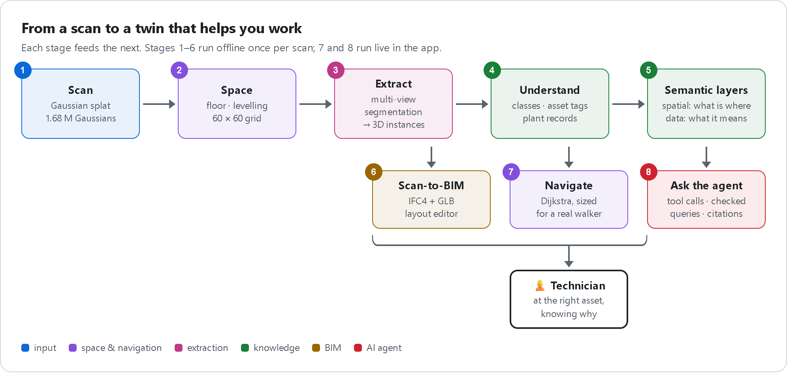
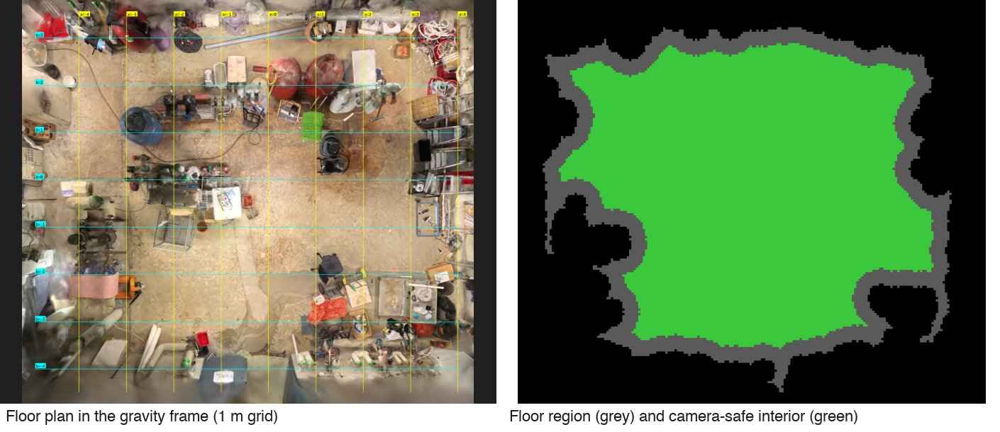
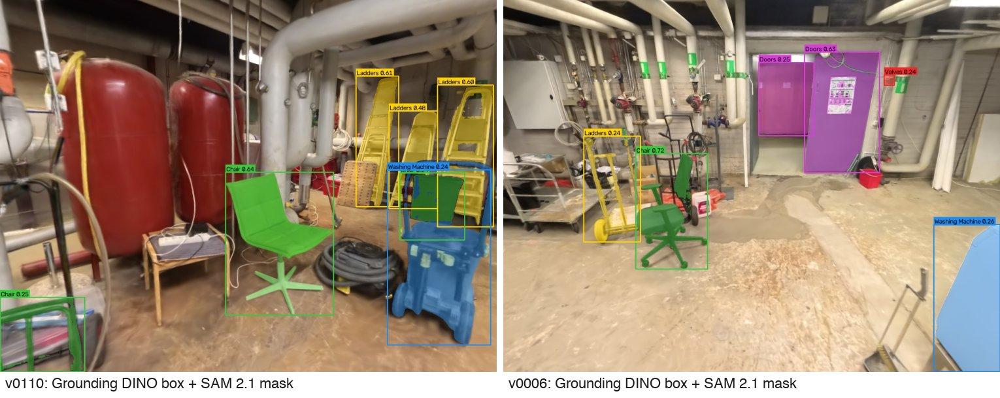
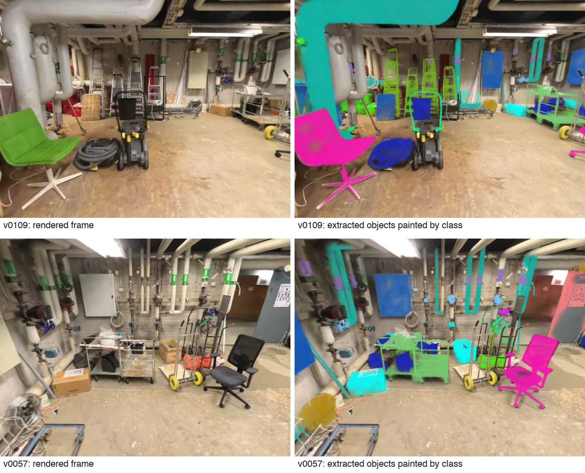
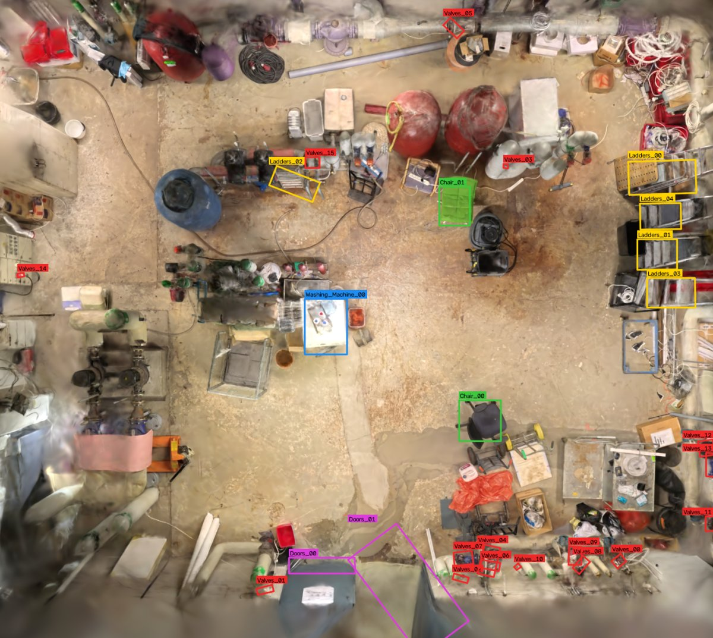
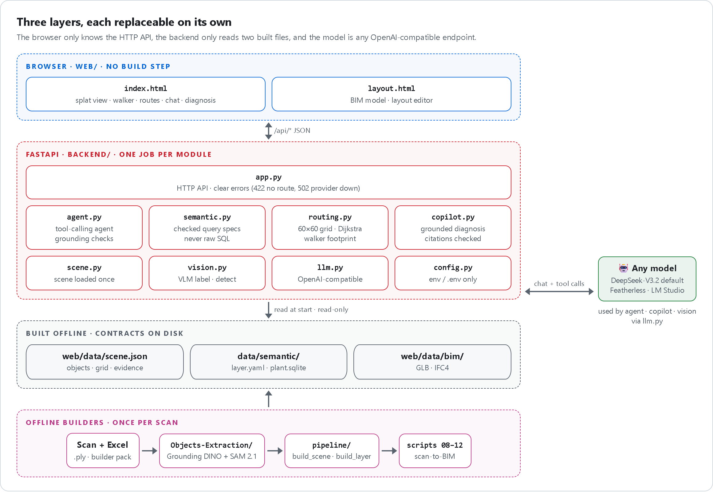
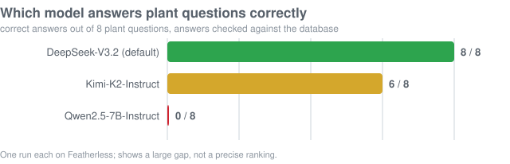
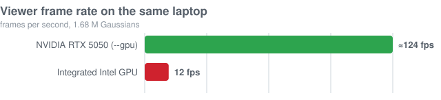
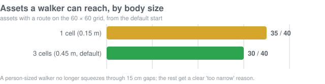
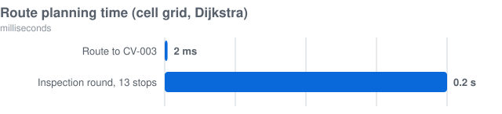

<h1 align="center">Field-Service Navigator</h1>

<p align="center">
  <b>From a Gaussian-splat scan to an intelligent industrial digital twin you can walk through and talk to.</b><br/>
  Valmet × Since AI 2026 · Industrial Metaverse challenge
</p>

## Demo video

<p align="center">
  <a href="docs/media/demo.mp4"></a><br/>
  <sub>Silent preview at 2× speed. ▶ <a href="docs/media/demo.mp4"><b>Watch the full 45-second video with narration</b></a> (MP4, 720p).<br/>
  A conceptual walk-through of the pipeline: scan → space → extraction → understanding → BIM → layers → navigation → AI agent. The app itself runs on the real scan.</sub>
</p>

<details>
<summary><b>What the video shows, scene by scene</b></summary>

| Time | Scene | What happens |
|---|---|---|
| 0–4 s | Splats | The scan assembles from Gaussian splats, still tilted as captured |
| 4–7 s | Space | The floor is found, the scan is levelled, the navigation grid draws itself and blocked cells rise |
| 7–10 s | Route | Dijkstra plans a path around the obstacles and a walker follows it |
| 10–15 s | Extract | A vision model proposes the object classes; camera views segment each object and every splat votes for its owner |
| 15–19 s | Classify | Objects are named, clutter is rejected, each one is checked against the asset register |
| 19–23 s | Scan-to-BIM | Each object becomes a clean surface model |
| 23–26 s | Layers | The twin separates into pipes, pumps, valves and tanks |
| 26–30 s | Twin | The twin finds the pump that needs inspection and plans the route |
| 30–45 s | Agent | *"What's wrong with PUMP-001?"*: tool calls, telemetry, knowledge layer, a cited answer, then *"take me there"* |
</details>

<p align="center">
  <a href="#demo-video">Demo</a> ·
  <a href="#the-flow">The flow</a> ·
  <a href="#what-you-can-do">What you can do</a> ·
  <a href="#architecture">Architecture</a> ·
  <a href="#repository-map">Repository map</a> ·
  <a href="#results">Results</a> ·
  <a href="#quick-start">Quick start</a> ·
  <a href="#documentation">Docs</a>
</p>

---

## The idea in three lines

1. **A scan is just millions of coloured blobs.** A field technician cannot ask it anything.
2. **We turn it into a twin that knows what it contains:** every piece of equipment is found, separated, named,
   linked to its plant records and rebuilt as a clean BIM model.
3. **Then the twin helps you work:** it walks you to the asset that needs attention and an AI agent explains what is
   wrong, with evidence from the plant data.

All plant data is the synthetic builder pack supplied for the challenge.

## The flow

Each stage feeds the next; the table under [What you can do](#what-you-can-do) links to how each one works.

<p align="center">
  <br/>
  <sub>HTML source: <a href="docs/diagrams/flow.html"><code>docs/diagrams/flow.html</code></a> · re-render with <code>docs/diagrams/render.py</code></sub>
</p>

<table>
<tr>
<td align="center" width="25%"><br/><sub><b>Space</b><br/>gravity frame and free floor</sub></td>
<td align="center" width="25%"><br/><sub><b>Extract</b><br/>detections on rendered views</sub></td>
<td align="center" width="25%"><br/><sub><b>Understand</b><br/>separate 3D instances</sub></td>
<td align="center" width="25%"><br/><sub><b>Navigate</b><br/>every object on the floor plan</sub></td>
</tr>
</table>

## What you can do

| Capability | How it works | Read more |
|---|---|---|
| **Walk the scan** | Real-time Gaussian splat in the browser (three.js + Spark), first-person or follow camera, drive with W/A/S/D | [Architecture](docs/architecture.md) |
| **See what is there** | 166 objects extracted; 40 carry full plant metadata (30 builder-pack assets + 10 grounded equipment) | [Data pipeline](docs/data-pipeline.md) |
| **Go to an asset** | Dijkstra on a 60 × 60 grid; the walker has a 0.45 m body, so routes only use gaps a person fits through | [Navigation](docs/navigation.md) |
| **Inspection round** | One route through every asset that needs attention, nearest-next | [Navigation](docs/navigation.md) |
| **Ask the agent** | *"What should we fix first?"*, *"take me to the pump with the highest vibration"*: tools, checked queries, cited answers | [Agent](docs/agent.md) |
| **Diagnose on arrival** | Grounded diagnosis that separates observation from hypothesis; citations outside the evidence are flagged | [Agent](docs/agent.md) |
| **See it as BIM** | IFC4 model and GLB overlay in scan coordinates, with a layout editor | [BIM export](Objects-Extraction/GroundingDino-SAM2/docs/bim-export.md) |
| **Use any model** | Featherless or LM Studio, chosen in the page; any OpenAI-compatible server | [API & config](docs/api.md) |

## Architecture

Three layers, each replaceable on its own. The browser only knows the HTTP API, the backend only knows two files,
and the model is any OpenAI-compatible endpoint.

<p align="center">
  <br/>
  <sub>HTML source: <a href="docs/diagrams/architecture.html"><code>docs/diagrams/architecture.html</code></a> · re-render with <code>docs/diagrams/render.py</code></sub>
</p>

More: [docs/architecture.md](docs/architecture.md), including how to extend each part.

## Repository map

```text
Since-AI/
├── backend/                 ⚙️  run-time API, one job per module
│   ├── app.py                   HTTP API and static files
│   ├── scene.py                 loads scene.json once: objects, evidence, grid
│   ├── routing.py               60×60 cell grid, Dijkstra, walker footprint
│   ├── agent.py                 tool-calling agent with grounding checks
│   ├── semantic.py              data semantic layer: specs, never raw SQL
│   ├── copilot.py               grounded per-asset diagnosis
│   ├── vision.py                vision-model labelling and detection
│   ├── llm.py                   OpenAI-compatible providers
│   └── config.py                settings from env / .env
├── web/                     🖥️  browser app, no build step
│   ├── index.html               navigator
│   ├── layout.html              BIM model and layout editor
│   └── data/                    scene.json, splat chunks, bim/
├── pipeline/                🛠️  offline builders: scan + Excel → app data
│   ├── build_scene.py           objects ↔ assets, grid → web/data/scene.json
│   ├── build_layer.py           data semantic layer → data/semantic/
│   ├── extract.py · semantic.py · refine_assets.py · navigator.py · view_splat.py
│   └── scene_catalog/           vision-model vocabulary discovery
├── Objects-Extraction/      🧩  Grounding DINO + SAM 2.1 extraction and scan-to-BIM
│   └── GroundingDino-SAM2/      scripts/01–13, splat_objects/, docs/
├── data/                    🗂️  semantic layers and added objects
│   ├── semantic/                knowledge.yaml (hand-written), layer.yaml, plant.sqlite
│   ├── objects/                 drop-in JSON objects
│   └── synthetic/               supplement records
├── data_format/             📄  object JSON format and examples
├── tests/                   ✅  102 tests, AI providers stubbed
├── docs/                    📚  architecture, navigation, agent, pipeline, API
│   ├── diagrams/                HTML/CSS diagrams + render.py → PNG
│   └── media/                   demo video, rendered diagrams, charts
├── start.sh · stop.sh       ▶️  start and stop the app
└── Dockerfile · pyproject.toml
```

## Results

<table>
<tr>
<td width="50%"></td>
<td width="50%"></td>
</tr>
<tr>
<td></td>
<td></td>
</tr>
</table>

- **Agent:** 12 of 12 real-scene requests right with DeepSeek-V3.2, including combined ones (query, then route). The
  cost is speed: a median of 29 s, against near-instant answers from the rule fallback.
- **Viewer:** loads in 1.4–1.9 s; about 124 fps on the laptop's NVIDIA GPU with `--gpu`.
- **Routing:** about 2 ms per route; a 13-stop inspection round in 0.2 s.

## Quick start

```bash
uv sync --all-extras            # backend, tests, pipeline
cp .env.example .env            # add FEATHERLESS_API_KEY, or use LM Studio
./start.sh                      # opens the app on the NVIDIA GPU (./start.sh --no-gpu: open http://127.0.0.1:8000)
./stop.sh                       # stops the server on that port
```

<details>
<summary><b>Other ways to run</b></summary>

```bash
uv run python -m backend --gpu  # what start.sh runs, by hand
docker build -t navigator . && docker run --env-file .env -p 8000:8000 navigator
```

For a local model, start the LM Studio server with a tool-capable chat model and pick it under **AI provider** in the
page. The committed `web/data/` and `data/semantic/` are enough to run the demo; rebuilding needs the scan and the
builder pack ([data pipeline](docs/data-pipeline.md)).
</details>

<details>
<summary><b>Using the viewer</b></summary>

1. Choose a destination tag, or ask the assistant (*"go to the valve that needs attention"*).
2. Press **Start**; the walker follows the route. Drive yourself with **W/A/S/D**, **R** re-plans from where you are.
3. **All boxes** or the class filter show the extracted objects; click one for its diagnosis card.
4. **AI analysis** runs only when you type a question and press **Ask**.
5. **Layout editor** opens the BIM model.
</details>

```bash
uv run pytest -q && uv run ruff check .    # tests use a stub instead of any AI provider
```

## Documentation

| Page | What is in it |
|---|---|
| [Architecture](docs/architecture.md) | Layers, module responsibilities, contracts, how to extend |
| [Data pipeline](docs/data-pipeline.md) | Scan → extraction → scene and semantic layer, rebuild commands, stage images |
| [Navigation](docs/navigation.md) | Grid, walker footprint, Dijkstra, route requests |
| [Agent](docs/agent.md) | Grounding rules, tools, semantic layers, model choice |
| [API & configuration](docs/api.md) | Endpoints, errors, environment variables |
| [Object format](data_format/README.md) | Add objects from people or other tools |
| [Extraction method](Objects-Extraction/GroundingDino-SAM2/docs/objects-extractio-pipeline.md) | Stage-by-stage extraction with figures |

## Known limits

- No authentication: the server binds to localhost by default. Put a gateway in front before exposing it.
- 7 of 30 builder-pack assets are not on a matching scanned object, and no vibration sensor is visible in the scan.
- With a 0.45 m walker, 10 of 40 assets sit behind gaps narrower than a person; the app says so instead of routing
  through them.
- The model comparison is one run of eight questions: it shows a large gap, not a precise ranking.
- A correct-looking query can still answer the wrong question. The checks catch invented figures, not a wrong filter,
  which is why the page always shows the table and the query.
- The demo video is a conceptual animation (procedural room); the app runs on the real scan.
