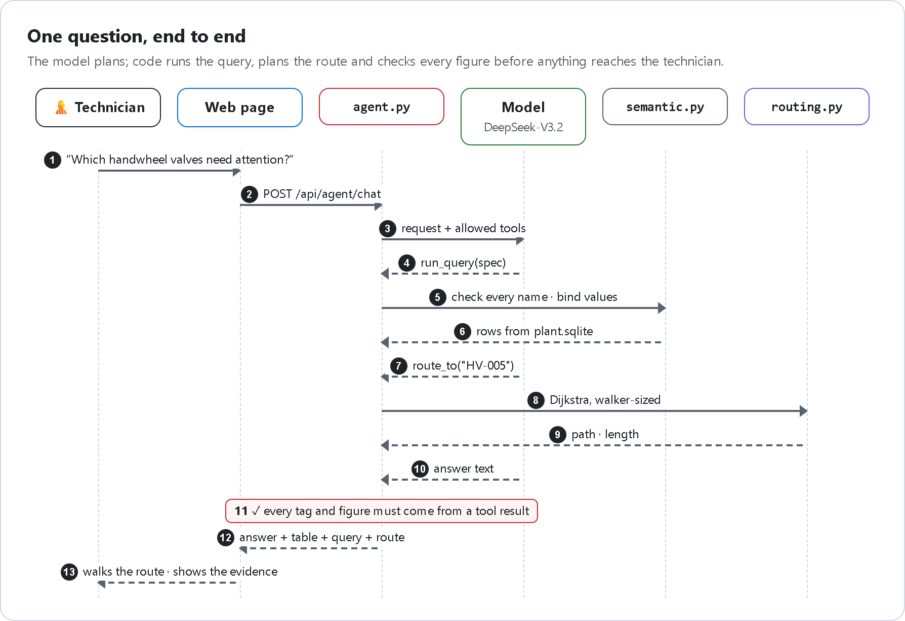
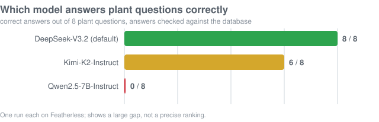

# The grounded AI agent

[← Back to README](../README.md)

Ask *"what's wrong with PUMP-001?"* or *"take me to the valve that needs attention"*. The agent answers from the
plant data and shows the evidence. **The model never writes SQL, never sets a path, and never has the last word on a
figure.**

   
  HTML source: <a href="diagrams/agent.html"><code>diagrams/agent.html</code></a> · re-render with <code>diagrams/render.py</code>

## Five rules that keep it grounded

1. **The model plans, code executes.** It chooses tools and can chain them (a telemetry query to find the pump with
   the highest vibration, then a route to it).
2. **Route tools only when you ask to go somewhere**, so a question can never move the technician.
3. **Queries are specs, not SQL.** Every name is checked against the layer and values are bound parameters. Unknown
   columns or values return errors the model can correct.
4. **Figures are checked.** If the answer has a figure or tag no tool returned, code replaces it with what the tools
   found, or says nothing was found.
5. **It works without a model.** With no provider, a failed call, or a trip the model did not route, rules handle
   navigation and the glossary.

## Tools

| Tool | Purpose |
|---|---|
| `search_layer`, `describe` | Find and explain entities, columns, reports and terms |
| `run_query`, `run_report` | Run a checked spec or a verified report |
| `search_assets`, `route_to`, `inspection_round` | Choose a destination and compute the path |
| `diagnose` | Grounded diagnosis with citations, shown as written |

## Two semantic layers

| Layer | File | Answers |
|---|---|---|
| **Spatial** | `data/semantic_layer.json`, `web/data/scene.json` | What is where in the scan, which object is which asset |
| **Data** | `data/semantic/layer.yaml`, `plant.sqlite` | What the plant records mean: entities, grain, units, synonyms, rules, proven joins, verified reports, glossary |

Hand-written knowledge lives in `knowledge.yaml`; `layer.yaml` is generated from it, the builder pack and the scene.

## Choosing a model

On the real scene with DeepSeek-V3.2, 12 of 12 test requests were right, including combined ones. The cost is
speed: a median of 29 s and up to 66 s, against near-instant answers from the rules. Change the offered models with
`FEATHERLESS_MODELS`, or point `LMSTUDIO_URL` at any local OpenAI-compatible server.
