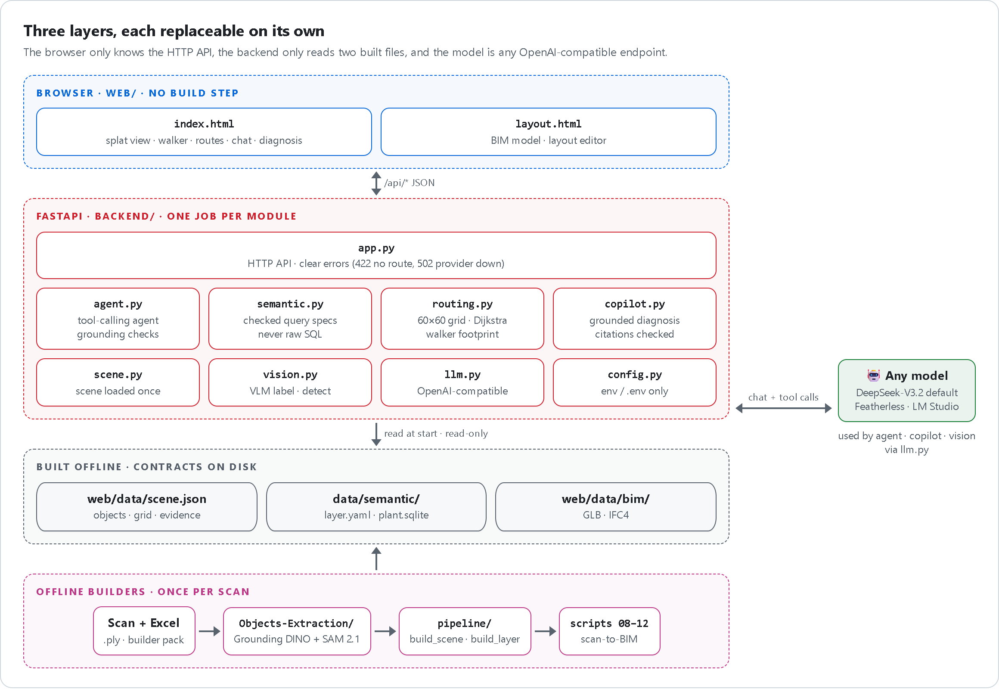

# Architecture

[← Back to README](../README.md)

The system has three layers. Each layer only talks to the one next to it, through a file or an HTTP contract.

   
  HTML source: <a href="diagrams/architecture.html"><code>diagrams/architecture.html</code></a> · re-render with <code>diagrams/render.py</code>

## Modules and their single job

| Module | Job | Talks to |
|---|---|---|
| [`backend/app.py`](../backend/app.py) | HTTP API and static files; maps errors to clear status codes | every backend module |
| [`backend/scene.py`](../backend/scene.py) | Loads `scene.json` once: objects, asset evidence, navigation grid | `routing.py` |
| [`backend/routing.py`](../backend/routing.py) | 60 × 60 cell grid, Dijkstra, walker footprint | — |
| [`backend/agent.py`](../backend/agent.py) | Chat agent: picks tools, checks every figure it says | `semantic.py`, `routing.py`, `copilot.py`, `llm.py` |
| [`backend/semantic.py`](../backend/semantic.py) | Data semantic layer: find, describe and query plant data from a checked spec | `plant.sqlite` |
| [`backend/copilot.py`](../backend/copilot.py) | Grounded diagnosis of one asset, citations checked | `llm.py` |
| [`backend/vision.py`](../backend/vision.py) | Vision-model labelling and detection on rendered views | `llm.py` |
| [`backend/llm.py`](../backend/llm.py) | Providers: every model is an OpenAI-compatible endpoint | network |
| [`backend/config.py`](../backend/config.py) | Settings from the environment or `.env`; no secret in code | — |
| [`web/index.html`](../web/index.html) | Navigator: splat view, walker, routes, chat, diagnosis cards | `/api/*` |
| [`web/layout.html`](../web/layout.html) | BIM model and layout editor | `web/data/bim/` |

## Why it is built this way

- **Swap any part.** The browser only knows the HTTP API. The backend only knows two files. The model is any
  OpenAI-compatible endpoint. A new scan, a new model or a new frontend replaces one box in the diagram.
- **The model never has the last word on facts.** It chooses tools; code runs the queries, plans the routes and checks
  every figure and tag in the answer (see [agent.md](agent.md)).
- **Build once, serve fast.** Heavy work (GPU extraction, joins, grid) happens offline. At run time a route takes
  about 2 ms and the page loads in under 2 s.
- **Read-only at run time.** The server never writes plant data. Removing an object only changes the live scene.

## Extending it

| You want to… | Change only |
|---|---|
| Use a different scan | Run the [data pipeline](data-pipeline.md); `scene.json` and the layer are rebuilt |
| Add objects by hand or from another tool | Drop a JSON file in `data/objects/` ([format](../data_format/README.md)) |
| Add a model or provider | Set it in `.env` ([api.md](api.md#configuration)); nothing in code |
| Add an agent tool | One function and one schema entry in `backend/agent.py` |
| Change the walker size | `SPRITE_CELLS` in `backend/routing.py` ([navigation.md](navigation.md)) |
