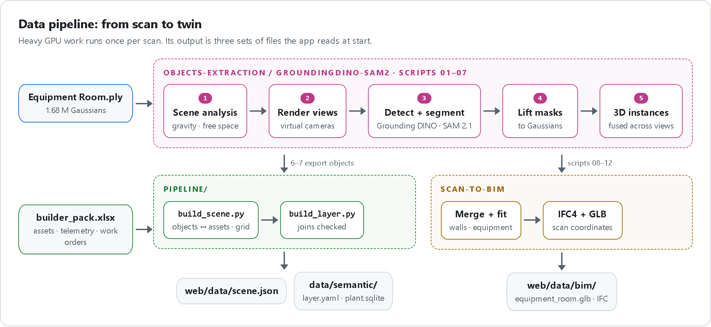
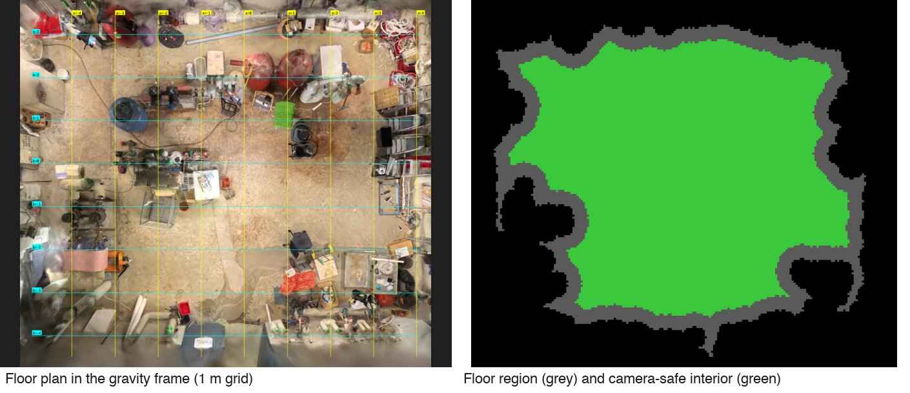
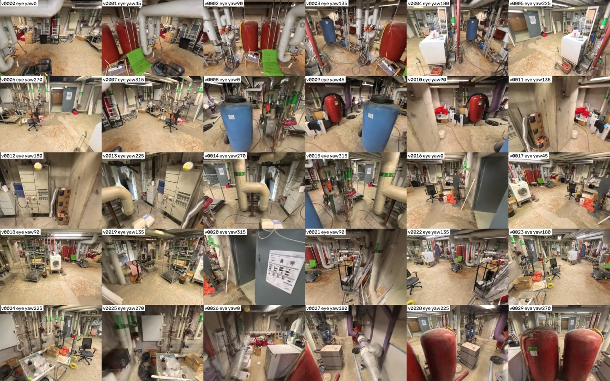
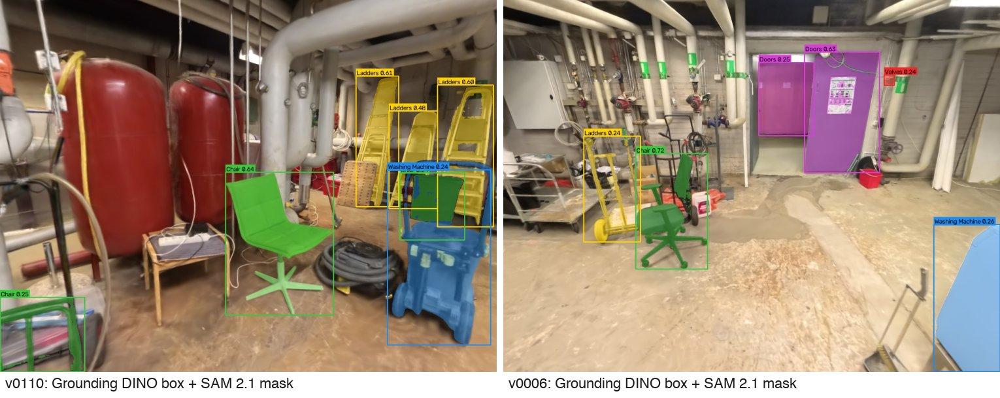
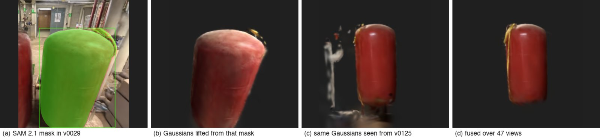
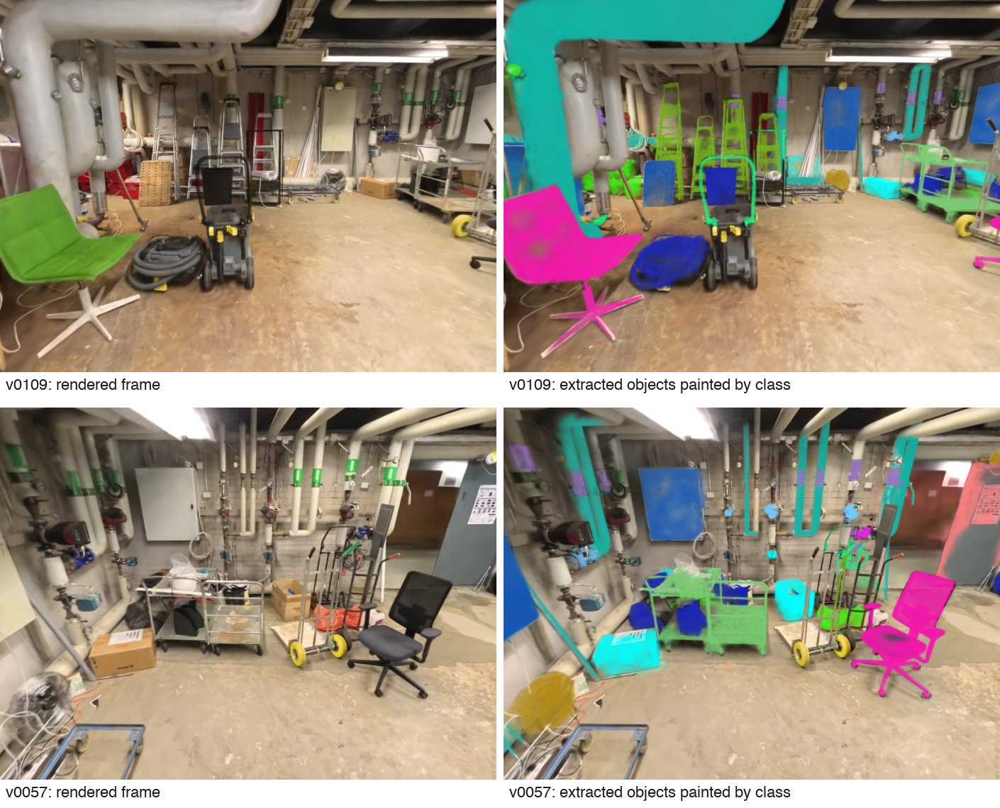
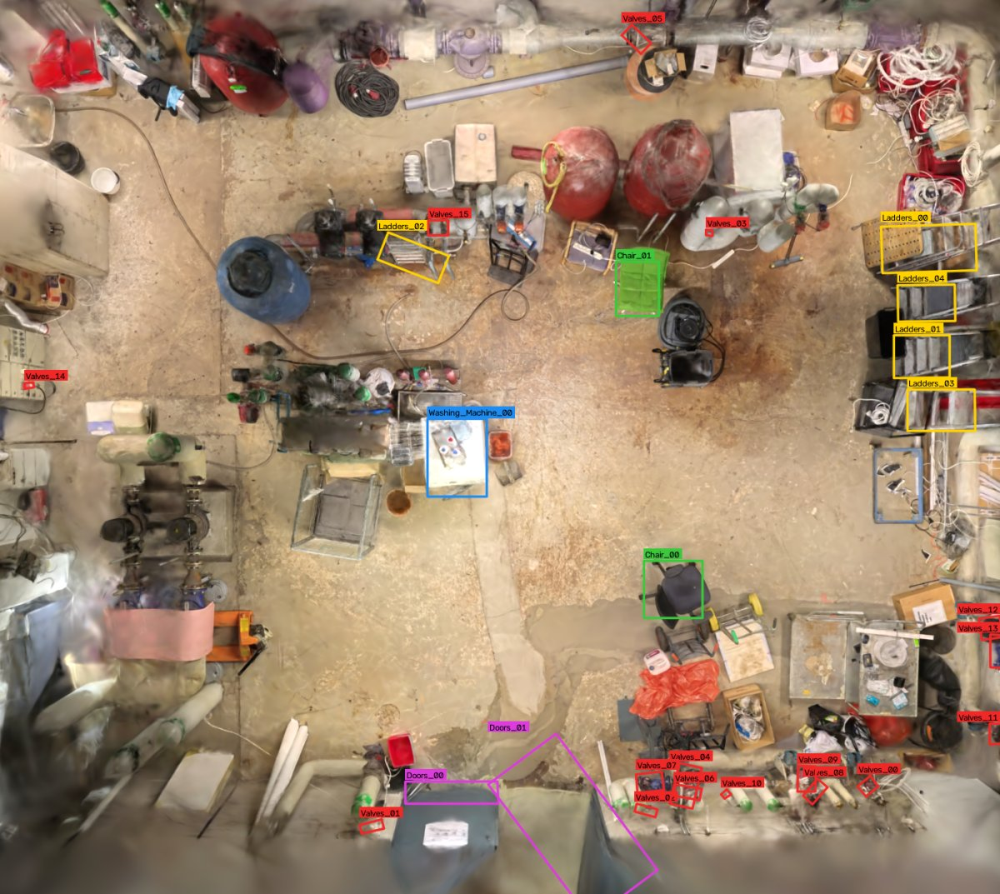

# Data pipeline: from scan to twin

[← Back to README](../README.md)

Everything heavy runs offline, once per scan. The output is three sets of files the app reads at start.

<p align="center">
  <br/>
  <sub>HTML source: <a href="diagrams/pipeline.html"><code>diagrams/pipeline.html</code></a> · re-render with <code>diagrams/render.py</code></sub>
</p>

## Object extraction, stage by stage

<table>
<tr>
<td align="center" width="33%"><br/><sub><b>1 · Scene analysis</b><br/>gravity frame and free space</sub></td>
<td align="center" width="33%"><br/><sub><b>2 · Rendered views</b><br/>virtual cameras through the room</sub></td>
<td align="center" width="33%"><br/><sub><b>3 · Detections</b><br/>Grounding DINO + SAM 2.1 masks</sub></td>
</tr>
<tr>
<td align="center"><br/><sub><b>4 · Lifting</b><br/>visibility-aware mask → Gaussian attribution</sub></td>
<td align="center"><br/><sub><b>5 · 3D instances</b><br/>masks fused across views</sub></td>
<td align="center"><br/><sub><b>Top-down check</b><br/>every instance on the floor plan</sub></td>
</tr>
</table>

Full method, design choices and limits: [objects-extraction pipeline](../Objects-Extraction/GroundingDino-SAM2/docs/objects-extractio-pipeline.md) ·
BIM export: [bim-export.md](../Objects-Extraction/GroundingDino-SAM2/docs/bim-export.md).

## Rebuild the app data

Needs the scan and the builder pack (symlinks at the repo root).

```bash
uv sync --extra pipeline
python pipeline/added_objects.py                          # validate data/objects/*.json
SKIP_SPLAT=1 python pipeline/build_scene.py "Equipment Room.ply" builder_pack.xlsx data/semantic_layer.json web
python pipeline/build_layer.py builder_pack.xlsx web/data/scene.json
```

Restart the backend afterwards (the scene is loaded once at start). `SKIP_SPLAT=1` keeps the splat chunks.
`build_layer.py` stops with an error if a join or a dashboard figure from the pack does not hold.

<details>
<summary><b>More pipeline tools</b></summary>

| Script | What it does |
|---|---|
| `pipeline/extract.py` | Extract objects from a splat into a semantic layer (needs the `extraction` extra and a GPU) |
| `pipeline/semantic.py` | Join every extracted object to its Excel data and floor cells |
| `pipeline/refine_assets.py` | Rebuild asset `.ply` files at higher quality with multi-view voting |
| `pipeline/export_assets.py` | Save objects whose Excel asset matches their type as separate `.ply` files |
| `pipeline/navigator.py` | Walkable occupancy map from any 3DGS `.ply` |
| `pipeline/view_splat.py` | Native splat viewer; finds the floor and levels the scan automatically |
| `pipeline/video_to_ply.py` | Turn a phone video into a splat `.ply` |
| `pipeline/make_supplement.py` | Synthetic records for the grounded equipment (`data/synthetic/`) |
| `pipeline/scene_catalog/` | Vision-model vocabulary discovery from rendered previews (Qwen3-VL) |

Scene vocabulary from previews:

```bash
uv run --with 'opencv-python>=4.10,<6' --with 'requests>=2.31,<3' \
  python -c "from pathlib import Path; from pipeline.scene_catalog.catalog import run_catalog; run_catalog(Path('renders/equipment_room/images'), Path('out/scene-catalog'), Path('.env'))"
```
</details>

## Add objects without re-running extraction

Drop a JSON file into `data/objects/` and rebuild. Format and examples: [data_format/README.md](../data_format/README.md).
