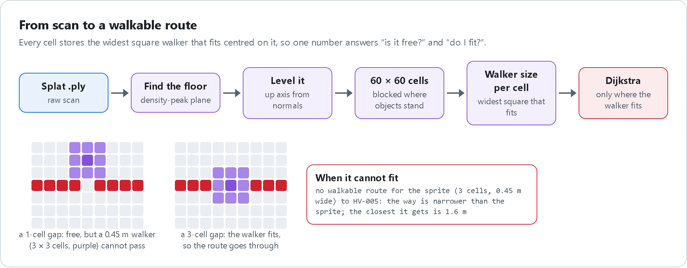
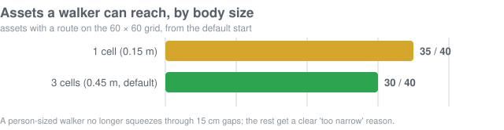
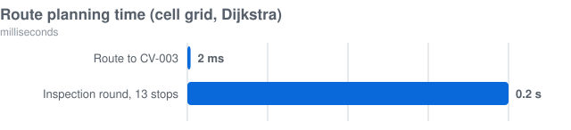

# Navigation

[← Back to README](../README.md)

## From scan to a walkable grid

   
  HTML source: <a href="diagrams/navigation.html"><code>diagrams/navigation.html</code></a> · re-render with <code>diagrams/render.py</code>

The grid is the numbered 60 × 60 grid over the floor (cell 1 is the top-left of the top view). Each cell stores the
widest square walker, in cells, that fits centred on it. That one number answers both questions a route needs:
*is the cell free?* and *does the walker fit here?*

## The walker has a body

The walker is **3 × 3 cells** (0.45 m wide, radius 0.225 m), set by `SPRITE_CELLS` in
[`backend/routing.py`](../backend/routing.py).

- Routes only use cells where the whole footprint fits, so a route never squeezes through a gap a person cannot pass.
- The start snaps to the nearest spot where the walker fits; of the floor areas within 1 m, the one that gets
  closest to the target is used.
- If the target cannot be reached, the answer says why:
  `no walkable route for the sprite (3 cells, 0.45 m wide) to HV-005: the way is narrower than the sprite; the closest it gets is 1.6 m`.
- The page reads the size from `/api/grids`: the ring around the walker shows it, and manual driving keeps the same
  distance from obstacles.
- Tight cells cost more, so routes keep to open floor when they can.

## Ask for a route

| From | To | Request |
|---|---|---|
| Where you are | An asset tag | `POST /api/route {"grid":"cells","position":[x,y,z],"target":"P-005"}` |
| A cell number | An asset tag | `POST /api/route {"grid":"cells","start_cell":1488,"target":"CV-003"}` |
| Anywhere | A cell number | `POST /api/route {"grid":"cells","target_cell":911}` |
| Where you are | Every asset that needs attention | `POST /api/route/round {"grid":"cells"}` (nearest-next order) |

Or just ask the assistant: *"take me to the pump with the highest vibration"*.

