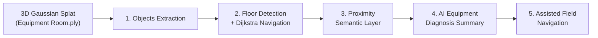

# Field Service Navigator: Features

A 3D Gaussian Splat of an equipment room turned into a navigable, equipment-aware field service tool.

## Flow

## Main Features

### 1. Objects Extraction
Runs the 6-step pipeline in [`Objects-Extraction/GroundingDino-SAM2/docs/objects-extractio-pipeline.md`](Objects-Extraction/GroundingDino-SAM2/docs/objects-extractio-pipeline.md) (Grounding DINO + SAM 2.1) on the full 3D Gaussian splat. It extracts objects (chairs, washing machine, valves, ladders, doors) and their semantic meaning as separate 3D objects.

### 2. Floor Detection and Dijkstra Navigation
Detects the floor and walkable space of the scene. It computes the shortest path to any chosen object using Dijkstra's algorithm.

### 3. Proximity Semantic Layer
While navigating in 3D, each piece of equipment shows a semantic layer built from its metadata. The layer appears when the user comes near it.

### 4. AI-Assisted Equipment Diagnosis
A DeepSeek model summarizes the equipment's condition and likely issues from the metadata available for it.

### 5. Assisted Field Navigation
Guides the field technician through the room to the equipment, using the navigation, semantic layer and AI summary together.

### 6. Scan-to-BIM (IFC4) overlay
Pipeline stages 8–12 in Grounding DINO + SAM 2 export an **IFC4** model and a semi-transparent **GLB** in scan coordinates. The web viewer’s **BIM** toggle lines walls and equipment up with the splat and existing semantic boxes. See [`Objects-Extraction/GroundingDino-SAM2/docs/bim-export.md`](Objects-Extraction/GroundingDino-SAM2/docs/bim-export.md).
